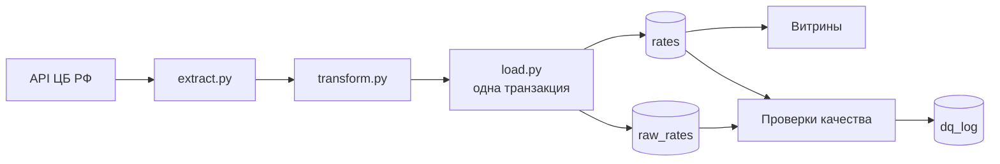

# CBR-ETL

[](https://github.com/withapoll/CBR-ETL/actions/workflows/tests.yml)

Batch-ETL курсов валют ЦБ РФ на Python и PostgreSQL: идемпотентная загрузка, бэкфилл, проверки качества.

В этом проекте я воссоздал процесс, который проходил бы, работая дата-инженером. Начал с постановки задачи.

**Стек:** Python 3.14, PostgreSQL 16, Docker, pytest, GitHub Actions.

## Задача

Каждый день забирать курсы валют ЦБ РФ, хранить историю и считать по ней витрины. Так, чтобы повторный запуск и догрузка прошлых дней ничего не ломали.

## Как устроено



| Слой | Что в нём |
|---|---|
| Источник | API ЦБ РФ |
| Raw | `raw_rates` — JSONB как пришло |
| Core | `rates` — строка на дату и валюту |
| Витрины | изменение за день, среднее по 7 публикациям, волатильность |
| Проверки | 6 SQL-проверок, итог в `dq_log` |
| Журнал | `load_log` — статус каждого запуска: `success`, `skipped`, `failed` |

## Три главных момента

**Идемпотентность.** Upsert по ключу «дата + валюта»: повторный запуск обновляет строки, а не плодит дубли. Сырой ответ и разобранные строки пишу одной транзакцией.

**Бэкфилл.** Флаг `--backfill N` догружает последние N дней. Упавшая дата не останавливает остальные, но процесс вернёт код 1, чтобы планировщик это увидел.

**Проверки качества.** После каждой загрузки: свежесть, пропуски публикаций, скачки курса, смена номинала. Проверка уровня `error` завершает запуск с ошибкой.

## Быстрый старт

Нужны Docker и Python 3.12 или новее (проверено на 3.14).

```bash
git clone https://github.com/withapoll/CBR-ETL.git
cd CBR-ETL
docker compose up -d
```

База поднимается на порту 5433 уже со схемой: миграции из `sql/migrations` выполняются при первом запуске контейнера.

```bash
python -m venv .venv
.venv\Scripts\activate          # Linux и macOS: source .venv/bin/activate
pip install -r requirements.txt
copy .env.example .env          # Linux и macOS: cp .env.example .env
```

Загрузка:

```bash
python src/main.py --backfill 30        # последние 30 дней
python src/main.py                      # сегодня
python src/main.py --date 2026-09-11    # конкретная дата
```

## Примеры

Изменение курса доллара к предыдущей публикации — [sql/marts/daily_change.sql](sql/marts/daily_change.sql):

```
 char_code | rate_date  | value_per_1 | change_pct
-----------+------------+-------------+------------
 USD       | 2026-10-08 |   85.481100 |     -0.269
 USD       | 2026-10-07 |   85.711600 |      0.919
 USD       | 2026-10-06 |   84.930900 |      1.733
 USD       | 2026-10-03 |   83.483900 |      0.287
 USD       | 2026-10-02 |   83.245400 |     -0.375
```

После выходных вторник сравнивается с субботой: курс, опубликованный на субботу, действует до вторника.

Самые волатильные валюты за период — [sql/marts/volatility.sql](sql/marts/volatility.sql):

```
 char_code | volatility_pct | n_changes
-----------+----------------+-----------
 BOB       |         3.9626 |        74
 IRR       |         1.2955 |        74
 BRL       |         1.0808 |        74
 EGP       |         0.9709 |        74
 ZAR       |         0.9481 |        74
```

Волатильность считается по дневным процентным изменениям, а не по самому курсу: иначе валюты ранжировались бы по номиналу, а не по риску.

## Проверки качества

Каждая проверка — SQL-файл в [sql/quality](sql/quality), который возвращает проблемные строки. Ноль строк — проверка пройдена.

| Проверка | Уровень | Что ловит |
|---|---|---|
| `non_positive` | error | нулевой или отрицательный курс или номинал |
| `missed_publication` | error | пропущенную публикацию: сверка с полем `PreviousDate` из ответа ЦБ |
| `freshness` | error | последняя дата старше 4 дней — пайплайн встал |
| `currency_count` | error | в дате заметно меньше валют, чем обычно |
| `rate_jump` | warning | курс за единицу изменился больше чем на 20% |
| `nominal_change` | info | ЦБ сменил номинал валюты |

Запуск отдельно от загрузки: `python src/quality.py`.

## Тесты и CI

Тесты на pytest. CI в GitHub Actions поднимает PostgreSQL и прогоняет их на каждый push.

```bash
pip install -r requirements-dev.txt
pytest -v
```

19 тестов. Модульные проверяют разбор ответа, реакцию на ответы API и повторы — без сети и базы. Интеграционные проверяют идемпотентность загрузки и проверки качества на отдельной базе `cbr_test`, которую тесты создают сами.

## Структура

```
├── docker-compose.yml        PostgreSQL 16, миграции подключены в контейнер
├── sql/
│   ├── migrations/           схема: 001_schema.sql, 002_dq_log.sql
│   ├── marts/                витрины
│   └── quality/              проверки качества
├── src/
│   ├── config.py             настройки из окружения
│   ├── extract.py            запрос к API
│   ├── transform.py          разбор ответа в строки
│   ├── load.py               запись в базу, журнал загрузок
│   ├── quality.py            запуск проверок
│   └── main.py               точка входа: --date, --backfill
└── tests/
```

## С какими проблемами столкнулся

1. **Дата курса ≠ дата запроса.** 20 сентября «сегодняшний» адрес ЦБ вернул курс на 19-е. Если бы подписывал данные датой запроса, один курс лёг бы под двумя датами, и ключ не спас бы. Сделал: дата берётся из ответа, разбор даты — в отдельной функции, чтобы правило жило в одном месте.

2. **Понедельник без курса.** После бэкфилла увидел, что за 21 сентября данных нет, а `PreviousDate` у 22-го — 19-е. Понял, что это свойство источника, и что проверка «все будни на месте» будет ругаться на каждый понедельник. Проверки качества должны ловить сбои, а не особенности источника.

3. **Зависание на мёртвой базе.** Docker не был запущен, бэкфилл висел минутами без ошибок. Добавил `connect_timeout`, чтобы падать быстро, и понял ограничение журнала в БД: о недоступности самой базы в неё не напишешь. Сделал так, чтобы ошибка журнала не заслоняла исходную причину.

4. **Сырой разброс врёт.** На данных за три месяца стандартное отклонение курса в рублях: у доллара 3,53, у иены 0,03 — по нему доллар «в 119 раз волатильнее». По дневным процентным изменениям всё наоборот: иена 0,94%, доллар 0,79%. Метрика, которая зависит от масштаба, ранжирует по номиналу, а не по риску.

5. **Боливиано и смена номинала.** Витрина волатильности поставила боливиано на первое место с отрывом: около 4% против ~1% у остальных. Разобрался: 30 июня ЦБ сменил номинал с 1 на 10. Колонка `value_per_1` отработала — без неё `value` прыгнул бы с 11,15 до 79,91, то есть на +617%. Но и после деления осталось реальное падение на 28% за один день, совпавшее со сменой номинала. Вывод: аномалия — повод разобраться, а не удалить строку. Проверка качества должна поднять флаг, а человек — решить, событие это или ошибка данных.

6. **Ответ уже был в проекте.** Проектируя проверки, придумал с нуля отдельную логику для смены номинала и календарь нерабочих дней. Потом увидел, что `value_per_1` уже делает смену номинала невидимой для проверки скачков, а источник сам присылает `PreviousDate` — предыдущую публикацию. Вывод: сначала смотреть, что уже есть в системе и в данных, потом придумывать.

## Что бы улучшил

- **dbt для витрин и проверок.** Сейчас всё сделано вручную, и в продакшене так лучше не делать. Но цель была другая: понять, что именно dbt автоматизирует, выстроив это руками. Витрины у меня — отдельные SQL-файлы, как модели dbt, а проверки возвращают проблемные строки, как его тесты.
- **Оркестратор** вместо ручного запуска.
- **Точность `Decimal` прямо при разборе JSON**, а не преобразованием из `float`: это убрало бы лишнее действие.
